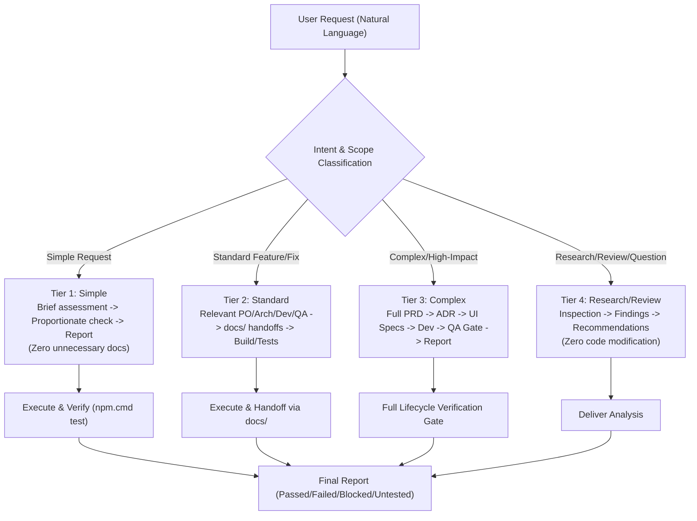

# Always-On Shared Agent Workflow (`shared-agent-workflow`)

This skill governs the autonomous multi-agent operating engine across **Antigravity**, **Claude Code**, and **Codex** for the SAURIK IT project.

---

## 1. Core Operating Mandate

**Every user request is processed through the shared workflow by default.**
The user does not need to specify "run the workflow", invoke specific roles, or name individual skills. You must automatically interpret intent, inspect context, select applicable responsibilities, perform authorized work, verify proportionately, and report results.

---

## 2. Scaled Workflow Tiers

| Tier | Request Classification | Required Responsibilities | Documentation & Handoffs | Verification Depth |
|---|---|---|---|---|
| **Tier 1: Simple** | Small, localized, reversible changes (e.g. tuning a constant, fixing a typo, updating copy). | Developer + QA Reviewer (self-review). | **Zero unnecessary documents or tests.** Do not create PRDs or handoffs. | Proportionate check (`npm.cmd test`). |
| **Tier 2: Standard** | Standard feature, multi-file bug fix, API route change, or service page update. | Relevant PO, Architect, Design, Developer, QA. | Create or update Markdown handoffs in `docs/` (`docs/tasks/`, `docs/qa/`, `docs/handoffs/`) where they help another role or session continue. | Automated test suite run (`npm.cmd test`), build check (`npm.cmd run build`), and focused assertion. |
| **Tier 3: Complex** | High-impact features, architectural pivots, new billing/telemetry platforms, voice pipelines. | Full pipeline: PO ➔ Architect ➔ UI/UX ➔ Developer ➔ QA Reviewer. | Full documentation set: PRD (`docs/product/`), ADR (`docs/decisions.md`), Design Specs (`docs/design/`), Implementation Tasks (`docs/tasks/`), QA Test Report (`docs/qa/`), and Master Handoff (`docs/handoffs/`). | Full automated test suite (11/11 tests), production build & SSG prerender (17/17 routes), and independent QA audit. |
| **Tier 4: Research / Review** | Questions, architecture assessments, accessibility audits, defect investigations, code explanations. | PO / Architect / QA analysis responsibilities. | **Zero code or file modifications** unless explicitly requested or authorized. | Static analysis, code inspection, or read-only checks. |

*User Override: If the user explicitly asks to skip a step or use a different process, follow that instruction within platform and safety constraints.*

---

## 3. The 6 Core Workflow Responsibilities

These are operational responsibilities, not a mandate to spawn 5 separate agents:
1. **Product Owner (`role-product-planner`)**: Clarify business intent, target personas, scope boundaries, and write testable Given/When/Then acceptance criteria.
2. **Solution Architect (`role-solution-architect`)**: Evaluate technical feasibility, system topology, API contracts, security boundaries, and record Architecture Decision Records (ADRs).
3. **UI/UX Designer (`role-ui-ux-designer`)**: Audit visual presentation, responsive adaptations (360px–1440px), component interaction states, and WCAG 2.2 AA accessibility.
4. **Developer (`role-fullstack-developer`)**: Implement authorized changes adhering to maintainable code standards (clean functions, modular design tokens, serverless timeouts).
5. **QA Reviewer (`role-qa-reviewer`)**: Rigorously verify against acceptance criteria, execute regression test suites, audit negative marketing constraints, and issue release recommendations.
6. **Shared Learning (`team-learning`)**: Perform Step 0 Pre-Flight memory reading (`agent-memory/`) and record verified empirical lessons.

---

## 4. Skill Routing & Maintainable Code

- **Automatic Skill Selection**: Select installed skills from `.agents/skills/` based on task context (e.g. `website-voice-integration` for TTS, `frontend-react-implementation` for components).
- **Maintainable Code Rule**: When available, invoke the `maintainable-code` skill. If unavailable, apply its core tenets directly from repository guidelines:
  - High cohesion, low coupling, single responsibility per module.
  - Strict input validation and fast-fail timeouts for API routes (`api/`).
  - Reusable Tailwind design tokens (`canvas`, `surface`, `ink`, `accent`) rather than arbitrary inline styles.
  - Report the limitation when a material skill is missing.
- **Never invent** a tool, skill, completed check, or test result.

---

## 5. Collaboration, Autonomy, and Escalation

- **Sequential Execution**: A single agent executes multiple responsibilities sequentially when separate agents are unavailable. Never fabricate collaboration claims.
- **Independent Review vs. Self-Review**: Prefer an independent reviewer subagent for Tier 3 changes. If unavailable, clearly mark the evaluation as **Self-Review**.
- **Autonomy**: Make routine, reversible implementation decisions independently. Do not stop at every step to ask trivial permission.
- **Escalation**: Escalate only when:
  - A business decision or scope question materially blocks progress.
  - An architectural constraint conflict occurs.
  - The **Anti-Thrashing Circuit Breaker** triggers (max 2 attempts on a failing build/test).
- **Hard Boundaries**: Never deploy, purchase services, send live external messages, or mutate production systems without human sign-off.

---

## 6. Pre-Flight and Post-Flight Learning Protocol

1. **Pre-Flight (Step 0)**: Read `agent-memory/<role>-lessons.md` and `agent-memory/shared-lessons.md`.
2. **Execution**: Apply only verified, relevant lessons. Distinguish assumptions from verified facts.
3. **Post-Flight**: If an empirical, reusable lesson was discovered, append it to `agent-memory/<role>-lessons.md` using the standard 10-field schema.
4. **Human Gatekeeper Rule**: Never unilaterally modify `AGENTS.md` to promote a lesson into a permanent rule. Only the human decision maker can approve rule promotions.

