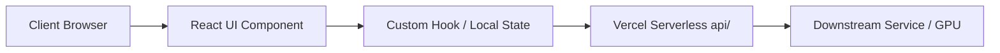

# Skill: Solution & System Design (`solution-design`)

The `solution-design` skill translates product requirements into robust, maintainable, and proportionate technical blueprints. It defines system topology, component hierarchies, data flows, and failure paths.

---

## 1. When to Use

Use this skill when:
- Designing a new feature, page architecture, or service integration.
- Updating system architecture in [`architecture.md`](file:///c:/Saurik/saurik_website/architecture.md).
- Establishing client vs. server responsibilities and failure-handling strategies.

---

## 2. The Proportionality Mandate (Anti-Overengineering)

The Architect must always deliver a solution proportionate to SAURIK IT's actual needs:
- **Default to Simplicity:** Prefer client-side React components + serverless Node.js endpoints (`api/`) over stateful servers, microservices, or complex databases.
- **On-Demand Infrastructure:** Only introduce databases (e.g. Supabase), queues, or external caches when explicitly necessitated by verified requirements (e.g. multi-user authentication or durable lead persistence).
- **Graceful Degradation First:** Every external integration must specify an immediate offline, timeout, or fallback state.

---

## 3. Core Solution Design Dimensions

Every system design must document the following 5 areas:

### 1. System Topology
- Identify execution tiers:
  - **Client Tier:** React 18 SPA + static HTML pre-rendered via Vite SSG.
  - **Edge / Serverless Tier:** Vercel Node.js Serverless Functions (`api/`).
  - **GPU / Compute Tier:** Serverless Modal.com containers running on-demand.
  - **External Integrations:** Email transports, WhatsApp deep-links, LLM provider APIs.

### 2. Component Hierarchy & Data Flow
- Map parent-to-child component composition.
- Identify state management approach (local state, custom React hooks, URL query params).
- Detail uni-directional data flow from triggers to UI updates.

### 3. Trust Boundaries & Secret Locations
- Document where sensitive credentials reside (strictly in serverless environment variables, never sent to browser).
- Specify sanitization points for user-submitted inputs.

### 4. Failure Paths & Timeout Budgets
- Specify timeout ceilings for all asynchronous or external operations (e.g., `MAYA_TTS_TIMEOUT_MS = 7500`).
- Detail fallback behavior when downstream dependencies fail (e.g., cascading from Maya to OpenAI, or displaying friendly retry copy while preserving entered form data).

### 5. Telemetry & Observable Headers
- Define telemetry headers to trace execution source (e.g., `X-TTS-Engine: maya2-native` vs `X-TTS-Engine: openai-tts-1`).

---

## 4. Solution Design Output Format

```markdown
# Solution Design: [Feature Name]

## 1. System Topology


## 2. Component Composition
- `src/components/[Feature]/[Component].jsx`: [Role and responsibilities]
- `src/hooks/use[Feature].js`: [Encapsulated state, network, and error logic]

## 3. Client vs. Server Boundaries
- **Client Owns:** [Validation, user feedback, DOM rendering, local caching]
- **Server Owns:** [API key protection, provider routing, payload transformation]

## 4. Failure Modes & Fallback Matrix
| Failure Scenario | Timeout Ceiling | System Response | User Experience |
|---|---|---|---|
| Downstream timeout | 7.5s | Fallback to secondary provider | Transparent completion |
| Total provider outage | Immediate | Return 502 with structured JSON | Friendly notice + preserved form |

## 5. Documentation Impact
- Updates required in [`architecture.md`](file:///c:/Saurik/saurik_website/architecture.md).
```

