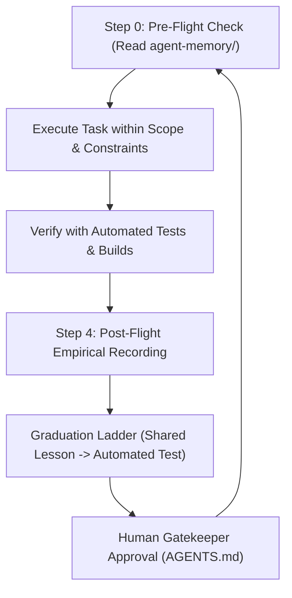

# Shared Skill: Team Recursive Learning (`team-learning`)

The `team-learning` skill operationalizes the recursive learning feedback loop for all agents in the SAURIK IT workspace.

Agents do not magically retrain model weights; they improve future decisions by **reading persistent project memory before acting, applying verified lessons, and recording empirical evidence after completing tasks**.



---

## 1. When to Use

Every agent must invoke this skill:
1. **At the start of every task (Step 0 Pre-Flight Check)**.
2. **When encountering failures or errors (Anti-Thrashing Circuit Breaker)**.
3. **Upon concluding a task (Step 4 Post-Flight Memory Recording)**.

---

## 2. Step 0: Pre-Flight Memory Check

Before writing a single line of code, requirement, or test:
1. **Read Role Memory:** Consult your role's specific memory file in `agent-memory/`:
   - Product: [`agent-memory/product-lessons.md`](file:///c:/Saurik/saurik_website/agent-memory/product-lessons.md)
   - Architect: [`agent-memory/architect-lessons.md`](file:///c:/Saurik/saurik_website/agent-memory/architect-lessons.md)
   - UI/UX: [`agent-memory/design-lessons.md`](file:///c:/Saurik/saurik_website/agent-memory/design-lessons.md)
   - Developer: [`agent-memory/developer-lessons.md`](file:///c:/Saurik/saurik_website/agent-memory/developer-lessons.md)
   - QA: [`agent-memory/qa-lessons.md`](file:///c:/Saurik/saurik_website/agent-memory/qa-lessons.md)
2. **Read Shared Memory:** Check [`agent-memory/shared-lessons.md`](file:///c:/Saurik/saurik_website/agent-memory/shared-lessons.md) for cross-cutting lessons.
3. **Filter Relevancy:** Apply only lessons directly applicable to the active task; ignore obsolete or superseded lessons.

---

## 3. Anti-Thrashing Circuit Breaker

To prevent circular token burn and infinite error loops:
- **Maximum 2 Attempts:** If a build, script, or test fails, make at most **two focused correction attempts**.
- **Hard Circuit Breaker:** If unresolved after two attempts, **STOP IMMEDIATELY**.
- **Action:** Document the exact failure, the root cause hypothesis, the two actions attempted, and escalate to **You (Human Decision Maker)** with clear options.

---

## 4. Post-Flight: Empirical Memory Recording

When a task concludes with a new, reusable insight, append a structured entry to your role's memory file in `agent-memory/`.

### Required Structured Schema
```markdown
## Lesson: [Descriptive Title]
- **Date:** YYYY-MM-DD
- **Role:** [Product | Architect | Designer | Developer | QA]
- **Task:** [Specific task being worked on]
- **Context:** [Relevant environment, OS, browser, or dependency]
- **Problem:** [What failed, was ambiguous, or caused rework]
- **Cause:** [Why it happened]
- **Action:** [What specific action resolved it]
- **Evidence:** [Exact test output, log line, or verification command]
- **Result:** [Verified outcome]
- **Status:** [Observed | Proposed | Verified | Superseded]
```

### Prohibitions
- Never record API keys, tokens, personal data, or private user information.
- Never record unverified opinions; mark unverified findings as `Status: Observed`.

---

## 5. Lesson Graduation Ladder & Human Gatekeeper

Empirical lessons graduate upwards through progressive levels of authority:

$$\text{Observation} \longrightarrow \text{Verified Role Lesson} \longrightarrow \text{Shared Lesson} \longrightarrow \text{Automated Test} \longrightarrow \text{Project Rule (AGENTS.md)}$$

1. **Automated Test Preference:** Whenever a recurring defect or invariant is identified, create an automated assertion script in `test/verify_*.cjs` rather than expanding prose rules.
2. **Human Gatekeeper Rule:** Agents must **never** unilaterally edit root `AGENTS.md` to promote a lesson into a permanent rule. Only **You (Human Decision Maker)** can grant approval to update project-level rules.

