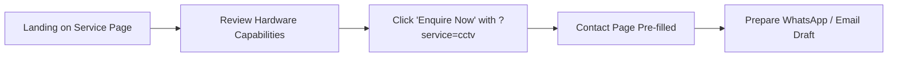

# Skill: User Journey Mapping & Information Architecture (`ux-journey-mapping`)

The `ux-journey-mapping` skill plans how visitors discover information, navigate between pages, and complete their goals on the SAURIK IT digital platform.

---

## 1. When to Use

Use this skill when:
- Designing new navigation structures or modifying route-level architecture.
- Planning multi-step user workflows (e.g. browsing services $\to$ selecting options $\to$ preparing contact draft).
- Identifying abandonment risks, dead ends, or points of friction in the user experience.

---

## 2. Core Journey Mapping Principles

### 1. Evidence-Based vs. Assumed Journeys
- **Grounding in Facts:** Ground journeys in verified pages and routes (`/`, `/software`, `/hardware`, `/about`, `/contact`, `/privacy`, `/use-cases`).
- **Hypothesis Labeling:** If user behavior is assumed rather than measured from real traffic, explicitly mark it as `[HYPOTHESIS]`. Never invent customer research or survey percentages.

### 2. Multi-Entry-Point Navigation
Visitors do not enter exclusively through the homepage:
- **Search / Direct Entry:** Visitors may land directly on `/services/cctv-installation` or `/track`. The journey must provide instant context and clear breadcrumbs back to core services.
- **Contextual Query Preservation:** When navigating from a service card to `/contact`, preserve the topic in the URL query string (e.g. `/contact?service=cctv`) so the contact form auto-selects the requested topic.

### 3. Friction & Abandonment Prevention
- Minimize clicks required to reach actionable contact options.
- Provide immediate, accessible fallbacks if a visitor does not want to use a specific channel (e.g. offering direct email and phone alongside WhatsApp).

---

## 3. Journey Map Output Format

```markdown
# User Journey Map: [Journey Name]

## 1. Visitor Persona & Entry Point
- **Persona:** [e.g. Small Business Retailer seeking CCTV security]
- **Entry Point:** Direct search landing on `/services/cctv-installation`

## 2. Step-by-Step Flow


## 3. Journey Steps & Information Needs
| Step | User Goal | Required Information | Potential Friction Point | Design Remedy |
|---|---|---|---|---|
| **1. Service Evaluation** | Understand offering | Verified specs & scope | Fear of hidden fees | Clear on-premise installation scope |
| **2. Contact Action** | Initiate enquiry | Contact form / WhatsApp | Mandatory company field | Make company optional for CCTV |
| **3. Draft Preparation** | Confirm details | Clear draft notice | Wondering if sent | Explicit "Draft prepared" message |

## 4. Information Architecture / Sitemap Impact
- Routes impacted: `[List of paths]`
- Navigation links updated: `[Header / Footer / Contextual CTA]`
```

