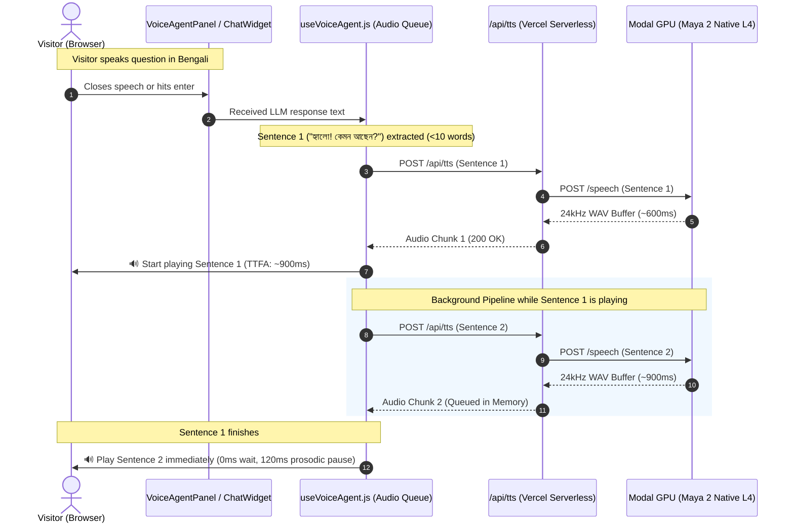

# Architecture Specification — FEAT-002: Maya TTS Latency Mitigation & Sentence Pipelining

## 1. Executive Summary & Architectural Invariants
- **Feature Tag**: `FEAT-002`
- **Architect**: Solution Architect (`role-solution-architect`)
- **Status**: Approved
- **Governing ADR**: ADR-004 (Pipelined Sentence Chunking & Background Audio Queue)
- **Primary Goal**: Reduce perceived Time To First Audio (TTFA) from ~4.5s down to $\le 1.2$s for regional voice synthesis on Modal Serverless GPU.

---

## 2. Component Topology & Data Flow



---

## 3. Technical Strategy & Decisions

### 3.1 Sentence Delimiter & Boundary Logic
Text is segmented using punctuation regex tailored for both Latin and Indic scripts:
```javascript
const splitSentencesForSpeech = (text) => {
  // Matches sentence terminators across English (.!?), Bengali/Hindi danda (।), and newlines
  const rawSentences = text.match(/[^.!?।\n]+[.!?।\n]*/g) || [text];
  const cleaned = [];
  let current = '';

  for (const part of rawSentences) {
    const trimmed = part.trim();
    if (!trimmed) continue;
    // Keep chunks between 5 and 25 words for optimal synthesis speed & natural prosody
    if ((current + ' ' + trimmed).split(/\s+/).length < 20) {
      current = current ? `${current} ${trimmed}` : trimmed;
    } else {
      if (current) cleaned.push(current);
      current = trimmed;
    }
  }
  if (current) cleaned.push(current);
  return cleaned.length > 0 ? cleaned : [text];
};
```

### 3.2 Sequential Audio Queue State Machine
In `src/hooks/useVoiceAgent.js`:
- `audioQueueRef`: Stores an array of synthesized Blob URLs ready for immediate playback.
- `activeAudioElementRef`: References the currently playing `HTMLAudioElement`.
- `fetchAbortControllerRef`: Aborts all pending background chunk fetches if the user interrupts or clicks Stop.
- `onended` handler on Chunk $N$ transitions directly to Chunk $N+1$ with `setTimeout(..., 100)` to ensure acoustic smoothness without popping.

### 3.3 Container Warm-Up Protocol
When the visitor opens the voice panel or enables microphone permissions, the client fires a non-blocking warmup request:
```javascript
fetch('/api/tts?warmup=true', { method: 'GET', keepalive: true }).catch(() => {});
```
This triggers Modal's fast health check, keeping the GPU container hot before the visitor finishes speaking their prompt.

---

## 4. Architectural Trade-Off Analysis

| Option | Pros | Cons | Recommendation |
|---|---|---|---|
| **Option A: Pipelined Sentence Queue (Chosen)** | Instant TTFA (<1.2s), works over standard HTTP/1.1 & HTTP/2, zero WebSocket infrastructure overhead, resilient to dropped connections. | Multiple HTTP calls for multi-sentence answers. | **Recommended (ADR-004)**: Best fit for serverless Vercel + Modal stack. |
| **Option B: Full WebSocket Streaming** | Continuous raw PCM stream, lowest server call count. | Complex state management on serverless, requires long-lived connection proxy, high failure surface on flaky mobile networks. | Rejected: Violates Proportionality Mandate. |
| **Option C: Quantize Model to 4-bit (AWQ/GPTQ)** | Reduces VRAM footprint by 50%. | Degrades Bengali & Indic speech inflection and naturalness; high engineering effort to re-export Maya 2 weights. | Deferred. |

---

## 5. Security & Privacy Architecture
- No PII or visitor identifiers sent to Modal.
- Audio payloads are cached in memory for session lifetime and released via `URL.revokeObjectURL()`.
- Bearer token authentication between Vercel and Modal remains secure in server environment variables.

