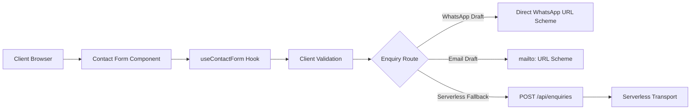

# Technical Architecture: Contact Form (`FEAT-001`)

## 1. Specification Metadata
- **Feature ID:** `FEAT-001`
- **Requirements:** [`docs/product/contact-form-requirements.md`](file:///c:/Saurik/saurik_website/docs/product/contact-form-requirements.md)
- **Design Spec:** [`docs/design/contact-form-design.md`](file:///c:/Saurik/saurik_website/docs/design/contact-form-design.md)
- **Architect:** Solution Architect (`role-solution-architect`)
- **Status:** Approved Reference Spec

---

## 2. System Topology & Data Flow



---

## 3. Client vs. Server Boundaries

- **Client Responsibilities:**
  - Validates required inputs (non-empty string, valid phone digits).
  - Encodes URI components safely using `encodeURIComponent`.
  - Dispatches to WhatsApp / Email scheme or calls serverless endpoint.
  - Preserves entered form state in React hook state upon failures.
- **Server Responsibilities (When using Serverless Endpoint):**
  - Strict method guard (`POST` only; other verbs reject with `405`).
  - Server-side payload validation and length limits ($< 5\text{KB}$).
  - Enforces fast-fail timeout ceiling ($5000\text{ms}$).
  - Protects private credentials; never logs customer PII.

---

## 4. API Contract (`POST /api/enquiries`)

### Request Payload Schema
```json
{
  "name": "Sourav Roy",
  "phone": "+919876543210",
  "service": "CCTV Installation",
  "company": "Optional Retail Store",
  "message": "Looking for 8 HD IP cameras with NVR."
}
```

### Response Schema
- **Success (`200 OK`):**
  ```json
  {
    "status": "success",
    "message": "Enquiry received. Our engineering team will contact you shortly.",
    "enquiryId": "ENQ-20261113-9182"
  }
  ```
- **Validation Failure (`400 Bad Request`):**
  ```json
  {
    "error": "Validation Error",
    "details": ["Name is required", "Phone must be a valid number"]
  }
  ```
- **Gateway Timeout / Downstream Offline (`502 Bad Gateway`):**
  ```json
  {
    "error": "Enquiry service temporarily unavailable",
    "code": "DOWNSTREAM_TIMEOUT",
    "directContact": { "phone": "+918420842220", "email": "contact@saurikit.in" }
  }
  ```

---

## 5. Security & Privacy Guardrails
1. **Zero Secret Exposure:** Any SMTP, SendGrid, or WhatsApp Business API tokens reside strictly in Vercel environment variables.
2. **Zero PII Logging:** Server logs must output only: `[ENQUIRY_SUBMITTED] { service: "cctv", latencyMs: 120, status: 200 }`.
3. **Safe Deep Links:** Format deep links using standard RFC-compliant URL encoding:
   ```javascript
   const waUrl = `https://wa.me/918420842220?text=${encodeURIComponent(text)}`;
   ```

