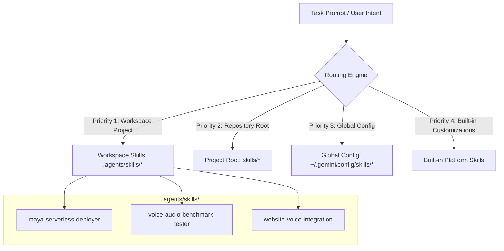
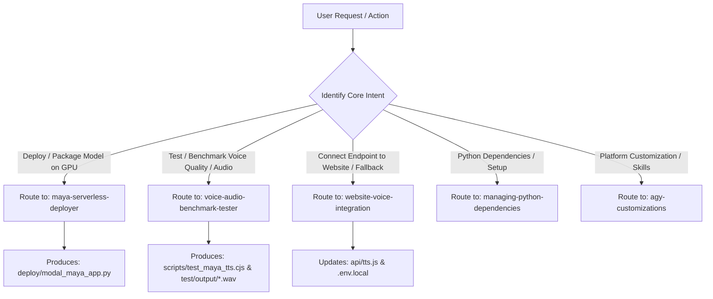

# SAURIK IT Skill Routing & Capability Architecture

This document defines the skill registry, discovery hierarchy, and intelligent routing matrix for the **SAURIK IT** digital platform and AI voice infrastructure.

---

## 1. Skill Discovery Hierarchy & Loading Precedence

Custom skills in this project follow Antigravity's progressive disclosure and loading hierarchy:



1. **Workspace Skills (`.agents/skills/<name>/SKILL.md`) [Highest Priority]:**  
   Tailored runbooks, deployment guides, and verification scripts checked directly into version control. Overrides any global or built-in skills with identical names.
2. **Project Rules (`AGENTS.md`, `GEMINI.md`):**  
   Strict non-negotiable negative constraints (e.g., Zero-Cost Native Voice Engine Rule, truthful marketing copy, zero unverified metrics).
3. **Global Config & Built-in Skills:**  
   Standard developer tooling for environment management, Python dependencies, and platform customizations.

---

## 2. Master Skill Registry

### 2.1. Dedicated Workspace Skills (Project Domain & Voice AI)

| Skill Name | Scope | Primary Trigger Keywords | Purpose & Operational Scope |
| :--- | :--- | :--- | :--- |
| **`maya-serverless-deployer`** | Workspace (`.agents/skills/maya-serverless-deployer/`) | `deploy maya`, `modal gpu`, `serverless tts`, `maya2-native`, `gpu packaging` | Configures, packages, and deploys the 2.5B parameter Maya 2 Native model to Modal Serverless GPU (NVIDIA L4/A10G). Sets up persistent HF weight volumes, PyTorch CUDA 12.8, auto-scaling to zero, and Bearer token security. |
| **`voice-audio-benchmark-tester`** | Workspace (`.agents/skills/voice-audio-benchmark-tester/`) | `test tts`, `benchmark audio`, `verify voice`, `tri-lingual test`, `latency check` | Executes automated tri-lingual benchmarks (English, Bengali, Hindi), measures warm vs. cold start latency, validates 24kHz audio sampling, verifies MIME types, and outputs playable test assets to `test/output/`. |
| **`website-voice-integration`** | Workspace (`.agents/skills/website-voice-integration/`) | `integrate voice`, `update api/tts`, `fallback tts`, `voice hook`, `zero-cost voice` | Bridges the serverless GPU endpoint with `api/tts.js` and `src/hooks/useVoiceAgent.js`. Strictly enforces the **Zero-Cost Native Voice Engine Rule** (browser-native speech remains primary; cloud GPU serves as regional fallback). |

### 2.2. Dedicated Multi-Agent Role Skills

| Skill Name | Scope | Primary Trigger Keywords | Purpose & Operational Scope |
| :--- | :--- | :--- | :--- |
| **`role-product-planner`** | Workspace (`.agents/skills/role-product-planner/`) | `product planner`, `prd`, `user stories`, `acceptance criteria`, `feature scope`, `roadmap` | Analyzes business intent, target user personas, defines user stories with Given/When/Then acceptance criteria, scopes boundaries, and audits negative marketing constraints. |
| **`role-ui-ux-designer`** | Workspace (`.agents/skills/role-ui-ux-designer/`) | `designer`, `wireframe`, `ui/ux`, `responsive layout`, `design tokens`, `accessibility`, `wcag` | Leads user journeys, page layouts, component interaction states, responsive viewports (360px–1440px), and WCAG 2.2 AA accessibility standards. |
| **`role-solution-architect`** | Workspace (`.agents/skills/role-solution-architect/`) | `architect`, `technical plan`, `system topology`, `api contract`, `data model`, `adr` | Decides technical choices, component hierarchies, data flows, serverless endpoint schemas, ADRs (`docs/decisions.md`), and implementation blueprints. |
| **`role-fullstack-developer`** | Workspace (`.agents/skills/role-fullstack-developer/`) | `developer`, `implement`, `build component`, `api route`, `code feature`, `fix bug` | Builds production-grade React 18 functional components, hooks, Tailwind styling, serverless `api/` routes, and automated regression tests. |
| **`role-qa-reviewer`** | Workspace (`.agents/skills/role-qa-reviewer/`) | `qa`, `reviewer`, `audit`, `verify`, `test suite`, `defect report`, `release recommendation` | Validates implementation against acceptance criteria, runs `npm test`, audits negative marketing constraints, checks WCAG 2.2 AA, and issues GO/NO-GO release recommendations. |

### 2.3. Modular Tactical & Cross-Role Skills

| Skill Name | Scope | Primary Trigger Keywords | Purpose & Operational Scope |
| :--- | :--- | :--- | :--- |
| **`po-discovery`** | Workspace (`.agents/skills/po-discovery/`) | `discovery`, `problem framing`, `target audience`, `business goal`, `assumptions` | Unpacks raw ideas into clear audience profiles, business objectives, and separates verified facts from assumptions. |
| **`deliver-prd`** | Workspace (`.agents/skills/deliver-prd/`) | `write prd`, `prd authoring`, `product requirements`, `in scope`, `out of scope` | Authors formal Product Requirements Documents with clear scope boundaries, journeys, NFRs, and maps to `docs/templates/prd-template.md`. |
| **`deliver-user-stories`** | Workspace (`.agents/skills/deliver-user-stories/`) | `user stories`, `acceptance criteria`, `given when then`, `dual path`, `happy path`, `recovery path` | Breaks down requirements into atomic user stories with Dual-Path Given/When/Then acceptance criteria (Happy Path + Failure/Recovery Path). |
| **`po-prioritization`** | Workspace (`.agents/skills/po-prioritization/`) | `prioritization`, `moscow`, `must have`, `should have`, `backlog order`, `scope cut` | Categorizes requirements using MoSCoW based on business value, launch necessity, and technical dependencies. |
| **`po-decision-management`** | Workspace (`.agents/skills/po-decision-management/`) | `clarification`, `open question`, `assumption check`, `taxonomy of truth`, `human gatekeeper` | Enforces the 5-category Taxonomy of Truth (Facts, Assumptions, Open Questions, Business Decisions, Technical Decisions). |
| **`architect-context-assessment`** | Workspace (`.agents/skills/architect-context-assessment/`) | `assess codebase`, `tech stack review`, `architect context`, `inspect repo` | Evaluates existing stack, routes, serverless runtime, active constraints, and prior architect lessons. |
| **`solution-design`** | Workspace (`.agents/skills/solution-design/`) | `system design`, `topology`, `component hierarchy`, `failure paths`, `proportionality` | Designs proportionate system architecture, component trees, client/server boundaries, and failure handling. |
| **`architecture-tradeoff-analysis`** | Workspace (`.agents/skills/architecture-tradeoff-analysis/`) | `trade-off`, `technology selection`, `compare options`, `vendor lock-in`, `reversibility` | Compares technical options systematically against cost, maintenance, security, and lock-in without fabricated stats. |
| **`architecture-decision-records`** | Workspace (`.agents/skills/architecture-decision-records/`) | `author adr`, `record decision`, `adr`, `decisions.md`, `technical commitment` | Authors and maintains Architecture Decision Records (ADRs) preserving context, drivers, and consequences in `docs/decisions.md`. |
| **`api-and-integration-design`** | Workspace (`.agents/skills/api-and-integration-design/`) | `api design`, `endpoint contract`, `request schema`, `response schema`, `fast-fail timeout` | Defines serverless API route schemas, status codes, telemetry headers, and timeout ceilings. |
| **`website-security-architecture`** | Workspace (`.agents/skills/website-security-architecture/`) | `security review`, `secret protection`, `input sanitization`, `pii privacy`, `anti-abuse` | Evaluates secret protection, input sanitization, anti-abuse/rate limiting, trust boundaries, and log privacy. |
| **`implementation-planning`** | Workspace (`.agents/skills/implementation-planning/`) | `implementation plan`, `ordered tasks`, `work breakdown`, `file checklist`, `rollback` | Breaks architectural designs into structured, ordered implementation tasks with file paths and test assertions. |
| **`developer-codebase-exploration`** | Workspace (`.agents/skills/developer-codebase-exploration/`) | `explore code`, `inspect components`, `codebase context`, `check routes` | Inspects existing component inventory, styles, routes, and developer lessons before editing code. |
| **`website-feature-implementation`** | Workspace (`.agents/skills/website-feature-implementation/`) | `implement feature`, `build feature`, `component logic`, `state handling` | Implements user stories into clean code with idle, loading, success, and error states (preserving form input). |
| **`frontend-react-implementation`** | Workspace (`.agents/skills/frontend-react-implementation/`) | `frontend react`, `responsive styling`, `tailwind layout`, `wcag a11y`, `keyboard navigation` | Builds responsive (360px–1440px), accessible (WCAG 2.2 AA) React components with Tailwind design tokens. |
| **`website-api-implementation`** | Workspace (`.agents/skills/website-api-implementation/`) | `build api`, `serverless route`, `input validation`, `fast-fail timeout` | Implements Vercel serverless endpoints (`api/`) with input validation, fast-fail timeouts, and telemetry. |
| **`systematic-debugging`** | Workspace (`.agents/skills/systematic-debugging/`) | `debug`, `troubleshoot`, `root cause`, `fix bug`, `investigate defect` | Methodical 6-step root-cause debugging under the 2-attempt anti-thrashing circuit breaker. |
| **`developer-testing`** | Workspace (`.agents/skills/developer-testing/`) | `developer test`, `author test`, `verify build`, `regression check` | Authors automated assertion scripts (`test/verify_*.cjs`) and verifies `npm test` & SSG production builds. |
| **`secure-web-implementation`** | Workspace (`.agents/skills/secure-web-implementation/`) | `secure coding`, `secret check`, `sanitize input`, `pii audit` | Enforces zero client secrets, server-only secret retrieval, input sanitization, and PII-free logging. |
| **`verification-before-completion`** | Workspace (`.agents/skills/verification-before-completion/`) | `verification check`, `verify completion`, `truthful handoff`, `untested audit` | Audits deliverables before handoff: transparently states what was tested, results, and what is unverified. |
| **`ux-design-brief`** | Workspace (`.agents/skills/ux-design-brief/`) | `design brief`, `ux context`, `brand alignment`, `audience needs` | Formulates design briefs evaluating business goals, user context, brand rules, and prior design lessons. |
| **`ux-journey-mapping`** | Workspace (`.agents/skills/ux-journey-mapping/`) | `journey map`, `sitemap`, `user flow`, `navigation structure`, `entry points` | Maps visitor journeys, sitemaps, entry points, and conversion flows, strictly labeling hypotheses. |
| **`website-wireframing`** | Workspace (`.agents/skills/website-wireframing/`) | `wireframe`, `page structure`, `content hierarchy`, `section order`, `layout blueprint` | Defines page structure, section sequence, and mobile-vs-desktop layout grids. |
| **`visual-design-and-art-direction`** | Workspace (`.agents/skills/visual-design-and-art-direction/`) | `visual design`, `art direction`, `color palette`, `typography hierarchy`, `lucide icons` | Establishes visual mood, typography hierarchy, palette application, and Lucide icon discipline. |
| **`website-design-system`** | Workspace (`.agents/skills/website-design-system/`) | `design tokens`, `design system`, `component states`, `button states`, `form states` | Manages design tokens and the 8 mandatory component interaction states. |
| **`responsive-interaction-design`** | Workspace (`.agents/skills/responsive-interaction-design/`) | `responsive design`, `viewport matrix`, `mobile menu`, `drawer`, `touch targets`, `reduced motion` | Specifies viewport adaptations (360px–1440px), mobile menu disclosures, and reduced motion. |
| **`accessibility-and-usability-review`** | Workspace (`.agents/skills/accessibility-and-usability-review/`) | `a11y review`, `wcag audit`, `contrast check`, `visible focus`, `touch target audit` | Conducts WCAG 2.2 AA audits, contrast checks ($\ge 4.5:1$), and visible focus verification. |
| **`qa-acceptance-review`** | Workspace (`.agents/skills/qa-acceptance-review/`) | `acceptance review`, `derive test scenarios`, `test matrix`, `happy path`, `failure path` | Deconstructs user stories into Happy Path, Failure Path, and Edge Case test scenarios. |
| **`qa-risk-based-test-planning`** | Workspace (`.agents/skills/qa-risk-based-test-planning/`) | `test plan`, `risk assessment`, `blast radius`, `qa depth`, `testing tiers` | Evaluates change blast radius (Tier 1 to 4) to select proportionate testing depth. |
| **`qa-browser-testing`** | Workspace (`.agents/skills/qa-browser-testing/`) | `browser testing`, `user flow test`, `test journey`, `form test`, `delivery check` | Exercises end-to-end user journeys, forms, and error states from a visitor's perspective. |
| **`qa-code-review`** | Workspace (`.agents/skills/qa-code-review/`) | `qa code review`, `independent diff review`, `unhandled error check`, `secret audit` | Audits code diffs for unhandled errors, secret leaks, missing tests, and shared component regressions. |
| **`qa-responsive-visual-review`** | Workspace (`.agents/skills/qa-responsive-visual-review/`) | `visual qa`, `responsive audit`, `viewport check`, `text overflow`, `layout bug` | Audits rendering across 360px–1440px viewports, text overflow, and layout fidelity against design tokens. |
| **`qa-accessibility-testing`** | Workspace (`.agents/skills/qa-accessibility-testing/`) | `qa accessibility`, `keyboard walkthrough`, `screen reader test`, `focus check` | Audits WCAG 2.2 AA: keyboard navigation, visible focus rings, form labels, and color contrast ($\ge 4.5:1$). |
| **`qa-api-integration-testing`** | Workspace (`.agents/skills/qa-api-integration-testing/`) | `api test`, `integration test`, `status code test`, `timeout test`, `fast fail audit` | Validates serverless endpoints (`api/`), status codes, 7.5s fast-fail timeouts, and telemetry headers. |
| **`qa-defect-triage-and-retest`** | Workspace (`.agents/skills/qa-defect-triage-and-retest/`) | `report bug`, `defect report`, `triage`, `retest`, `severity`, `steps to reproduce` | Standardizes reproducible defect reports with severity ratings and verifies post-fix retests. |
| **`qa-release-readiness`** | Workspace (`.agents/skills/qa-release-readiness/`) | `release readiness`, `go no go`, `qa recommendation`, `release gate`, `readiness report` | Synthesizes test runs into an evidence-based GO / NO-GO recommendation (Passed, Failed, Blocked, Untested). |
| **`agent-handoff`** | Workspace (`.agents/skills/agent-handoff/`) | `agent handoff`, `handoff packet`, `pass to architect`, `pass to developer`, `pass to qa` | Standardizes structured, self-contained handoff packages across all specialist agents, mapping to `docs/templates/handoff-template.md`. |
| **`team-learning`** | Workspace (`.agents/skills/team-learning/`) | `recursive learning`, `pre-flight check`, `anti-thrashing`, `post-flight`, `graduation ladder` | Operationalizes Step 0 Pre-Flight memory reading, Anti-Thrashing Circuit Breaker (max 2 attempts), post-flight empirical logging, and the Lesson Graduation Ladder. |

### 2.4. Core System & Developer Tooling Skills

| Skill Name | Scope | Primary Trigger Keywords | Purpose |
| :--- | :--- | :--- | :--- |
| **`agy-customizations`** | Built-in | `customization`, `skills`, `rules`, `plugins`, `hooks` | Reference guide for the Antigravity customization engine, loading priority, and syntax. |
| **`managing-python-dependencies`** | Plugin | `pip install`, `virtualenv`, `venv`, `requirements.txt` | Ensures isolated Python virtual environment management, preventing global package pollution. |
| **`accidental-data-loss-prevention`** | Plugin | `delete`, `drop`, `truncate`, `rm -rf`, `purge` | Safety check requiring explicit user confirmation prior to any irreversible data destruction. |
| **`automation`** | Built-in | `schedule`, `recurring`, `cron`, `background task` | Guides the design of scheduled background automations and recurring agents. |

---

## 3. Intelligent Intent Routing Matrix

When a user request is received, the agent evaluates the intent against this decision matrix:



---

## 4. Execution Workflow for Maya 2 Native Implementation

To implement and verify Maya 2 Native safely without breaking live traffic, the skills are invoked in sequential order:

```
[Phase 1: Skill Invocation - maya-serverless-deployer]
   └── Generates: deploy/modal_maya_app.py
   └── Configures: NVIDIA L4 GPU, persistent volume, Bearer token security, OpenAI-compatible endpoint.

[Phase 2: Skill Invocation - voice-audio-benchmark-tester]
   └── Generates: scripts/test_maya_tts.cjs
   └── Configures: Tri-lingual benchmark (EN, BN, HI) and automated file verification in test/output/.

[Phase 3: Skill Invocation - website-voice-integration]
   └── Configures: api/tts.js proxy with MAYA_TTS_ENDPOINT & MAYA_TTS_KEY
   └── Verifies: Zero-Cost Native Engine rule compliance (browser-native speech remains primary).
```

---

## 5. Multi-Agent Development Team

The repository maintains an official multi-agent development team defined in `.agents/team/roles.md`:

| Agent Role | Subagent Name | Responsibility | Deliverables |
|---|---|---|---|
| **Product / Planner** | `product_planner` | Understand business goals, target users, features & priorities; clarify ambiguities | PRD, User Stories, Acceptance Criteria |
| **UI/UX Designer** | `ui_ux_designer` | User journeys, page structure, layouts, responsive design & accessibility | Wireframes, Design Tokens, Responsive Specs |
| **Architect** | `solution_architect` | Tech decisions, topology, component hierarchy, API contracts & implementation plan | Architecture (`architecture.md`), Technical Plan |
| **Developer** | `fullstack_developer` | Production-grade code, serverless endpoints, CSS & automated tests | Working code, automated tests (`test/`) |
| **QA / Reviewer** | `qa_reviewer` | Verify against acceptance criteria, regression tests, negative constraints & WCAG audit | Test Execution Report, Actionable Defect Log |
| **Human Decision Maker** | `You` | Strategic decisions, trade-offs, milestones review | Approval or Course-Correcting Feedback |


