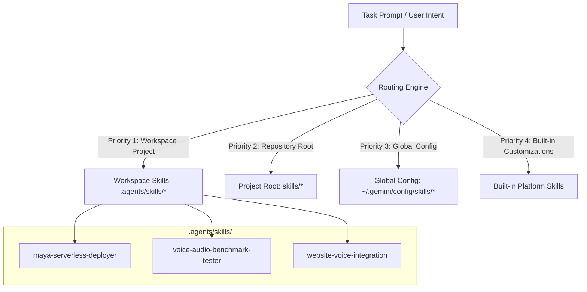
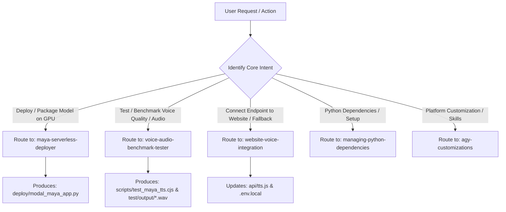

# SAURIK IT Skill Routing & Capability Architecture

This document defines the skill registry, discovery hierarchy, and intelligent routing matrix for the **SAURIK IT** digital platform and AI voice infrastructure.

---

## 1. Skill Discovery Hierarchy & Loading Precedence

Custom skills in this project follow Antigravity's progressive disclosure and loading hierarchy:



1. **Workspace Skills (`.agents/skills/<name>/SKILL.md`) [Highest Priority]:**  
   Tailored runbooks, deployment guides, and verification scripts checked directly into version control. Overrides any global or built-in skills with identical names.
2. **Project Rules (`AGENTS.md`, `GEMINI.md`):**  
   Strict non-negotiable negative constraints (e.g., Zero-Cost Native Voice Engine Rule, truthful marketing copy, zero unverified metrics).
3. **Global Config & Built-in Skills:**  
   Standard developer tooling for environment management, Python dependencies, and platform customizations.

---

## 2. Master Skill Registry

### 2.1. Dedicated Workspace Skills (Project Domain & Voice AI)

| Skill Name | Scope | Primary Trigger Keywords | Purpose & Operational Scope |
| :--- | :--- | :--- | :--- |
| **`maya-serverless-deployer`** | Workspace (`.agents/skills/maya-serverless-deployer/`) | `deploy maya`, `modal gpu`, `serverless tts`, `maya2-native`, `gpu packaging` | Configures, packages, and deploys the 2.5B parameter Maya 2 Native model to Modal Serverless GPU (NVIDIA L4/A10G). Sets up persistent HF weight volumes, PyTorch CUDA 12.8, auto-scaling to zero, and Bearer token security. |
| **`voice-audio-benchmark-tester`** | Workspace (`.agents/skills/voice-audio-benchmark-tester/`) | `test tts`, `benchmark audio`, `verify voice`, `tri-lingual test`, `latency check` | Executes automated tri-lingual benchmarks (English, Bengali, Hindi), measures warm vs. cold start latency, validates 24kHz audio sampling, verifies MIME types, and outputs playable test assets to `test/output/`. |
| **`website-voice-integration`** | Workspace (`.agents/skills/website-voice-integration/`) | `integrate voice`, `update api/tts`, `fallback tts`, `voice hook`, `zero-cost voice` | Bridges the serverless GPU endpoint with `api/tts.js` and `src/hooks/useVoiceAgent.js`. Strictly enforces the **Zero-Cost Native Voice Engine Rule** (browser-native speech remains primary; cloud GPU serves as regional fallback). |

### 2.2. Core System & Developer Tooling Skills

| Skill Name | Scope | Primary Trigger Keywords | Purpose |
| :--- | :--- | :--- | :--- |
| **`agy-customizations`** | Built-in | `customization`, `skills`, `rules`, `plugins`, `hooks` | Reference guide for the Antigravity customization engine, loading priority, and syntax. |
| **`managing-python-dependencies`** | Plugin | `pip install`, `virtualenv`, `venv`, `requirements.txt` | Ensures isolated Python virtual environment management, preventing global package pollution. |
| **`accidental-data-loss-prevention`** | Plugin | `delete`, `drop`, `truncate`, `rm -rf`, `purge` | Safety check requiring explicit user confirmation prior to any irreversible data destruction. |
| **`automation`** | Built-in | `schedule`, `recurring`, `cron`, `background task` | Guides the design of scheduled background automations and recurring agents. |

---

## 3. Intelligent Intent Routing Matrix

When a user request is received, the agent evaluates the intent against this decision matrix:



---

## 4. Execution Workflow for Maya 2 Native Implementation

To implement and verify Maya 2 Native safely without breaking live traffic, the skills are invoked in sequential order:

```
[Phase 1: Skill Invocation - maya-serverless-deployer]
   └── Generates: deploy/modal_maya_app.py
   └── Configures: NVIDIA L4 GPU, persistent volume, Bearer token security, OpenAI-compatible endpoint.

[Phase 2: Skill Invocation - voice-audio-benchmark-tester]
   └── Generates: scripts/test_maya_tts.cjs
   └── Configures: Tri-lingual benchmark (EN, BN, HI) and automated file verification in test/output/.

[Phase 3: Skill Invocation - website-voice-integration]
   └── Configures: api/tts.js proxy with MAYA_TTS_ENDPOINT & MAYA_TTS_KEY
   └── Verifies: Zero-Cost Native Engine rule compliance (browser-native speech remains primary).
```

